

  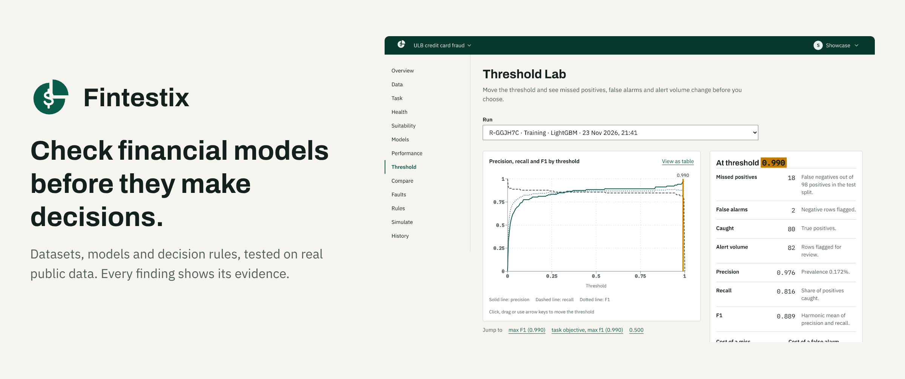

  
  
   
  
  
  
  
  
  
  
  
  
  
  
  
  
  

  <b>Fintestix checks financial datasets, models and decision rules, and shows the evidence behind every finding.</b> 
  <a href="#see-it">See it</a> ·
  <a href="#how-it-works">How it works</a> ·
  <a href="#architecture">Architecture</a> ·
  <a href="#measured-results">Results</a> ·
  <a href="#engineering">Engineering</a>

<picture>
  <source media="(prefers-color-scheme: dark)" srcset="docs/images/at-a-glance-dark.png">
  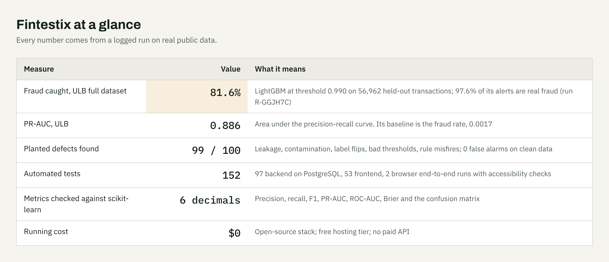
</picture>

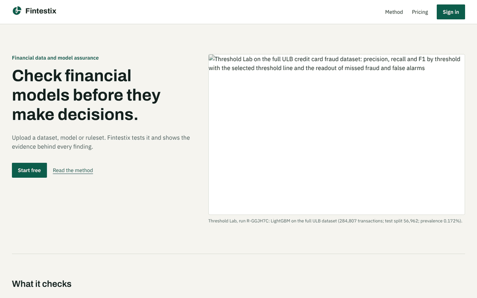

## The problem

A fraud model can score 99.8% accuracy while catching almost no fraud, because fraud is 0.17% of transactions. Columns that are only known after the outcome make models look better than they are. Business rules quietly conflict. **Fintestix tests all of this on your data and shows the proof for every finding.**

## See it

<table>
<tr>
<th width="50%">Threshold Lab</th>
<th width="50%">Model performance</th>
</tr>
<tr>
<td>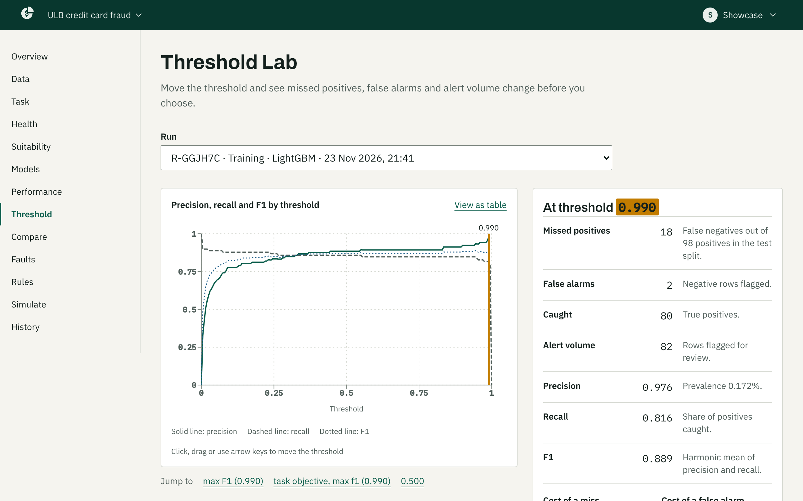</td>
<td>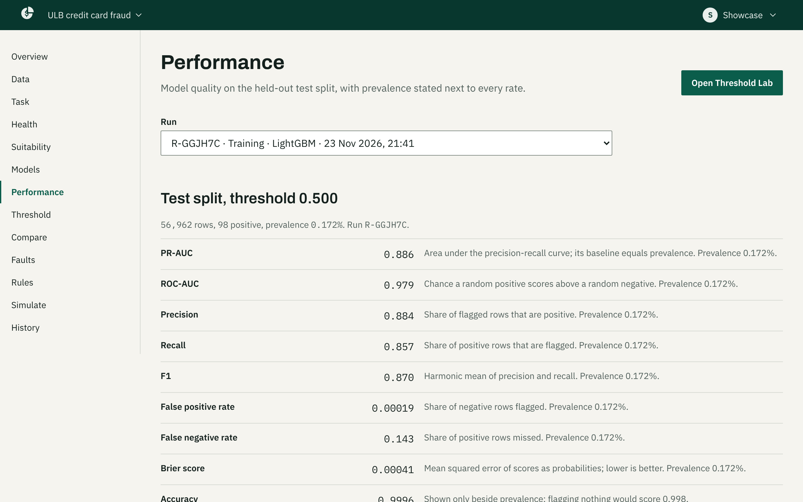</td>
</tr>
<tr>
<td>Move the threshold and see missed fraud, false alarms and alert volume before choosing.</td>
<td>Every rate is shown with the prevalence it depends on. Metrics that cannot be computed say so.</td>
</tr>
<tr>
<th>Fault Checker</th>
<th>Decision rules against an independent oracle</th>
</tr>
<tr>
<td>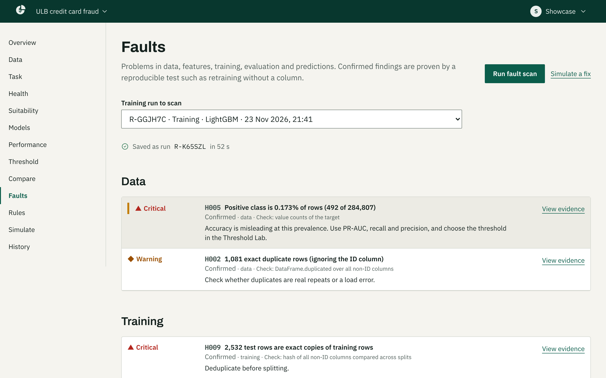</td>
<td>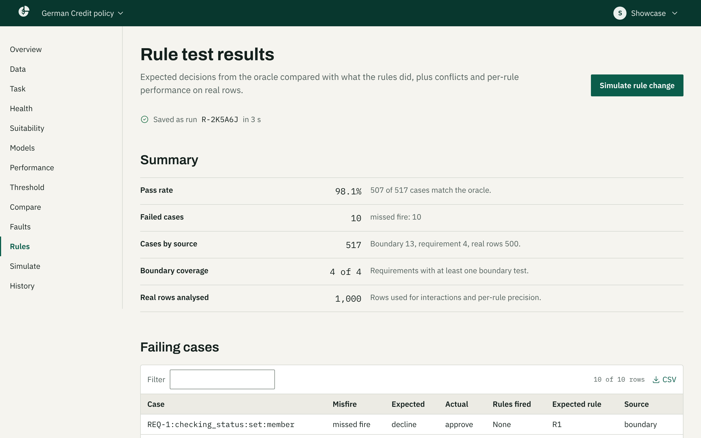</td>
</tr>
<tr>
<td>Leakage is confirmed by retraining without the column, not guessed.</td>
<td>Expected decisions come from the written requirements, never from the rule code.</td>
</tr>
<tr>
<th>Change simulator</th>
<th>Sign-up with an emailed code</th>
</tr>
<tr>
<td>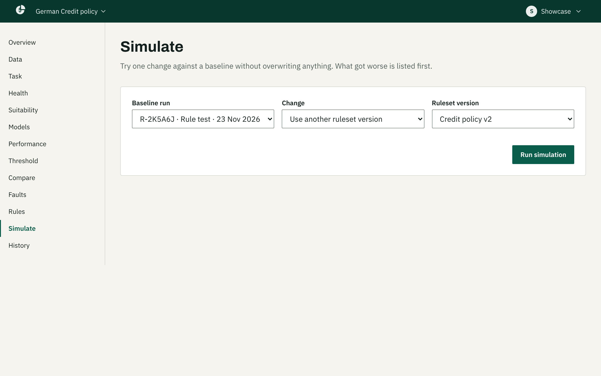</td>
<td>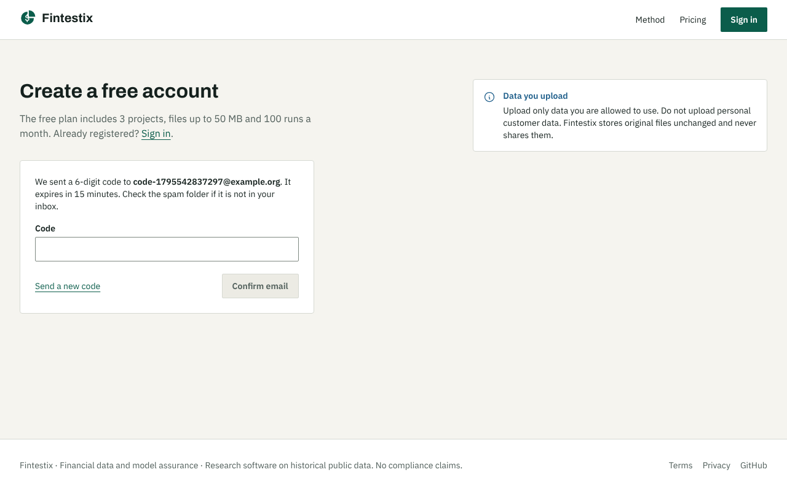</td>
</tr>
<tr>
<td>Try a threshold, rule, feature or model change without touching the original.</td>
<td>A 6-digit code confirms the email before the first sign-in. Free plan included.</td>
</tr>
</table>

## How it works

<picture>
  <source media="(prefers-color-scheme: dark)" srcset="docs/images/how-it-works-dark.png">
  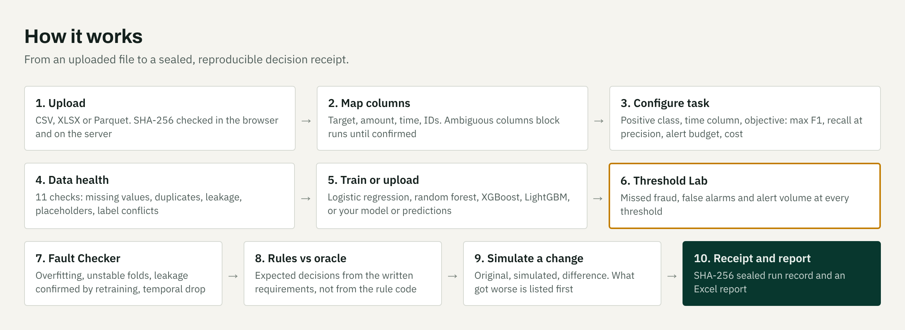
</picture>

## Architecture

<picture>
  <source media="(prefers-color-scheme: dark)" srcset="docs/images/architecture-dark.png">
  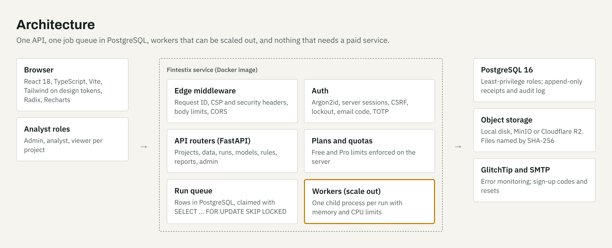
</picture>

<picture>
  <source media="(prefers-color-scheme: dark)" srcset="docs/images/inside-the-backend-dark.png">
  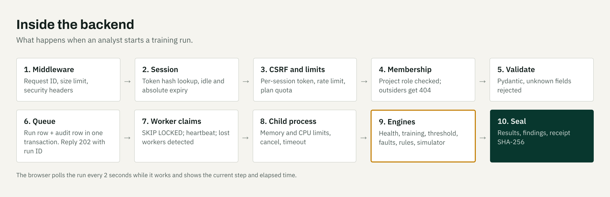
</picture>

<table>
<tr>
<td width="50%"><picture><source media="(prefers-color-scheme: dark)" srcset="docs/images/data-model-dark.png">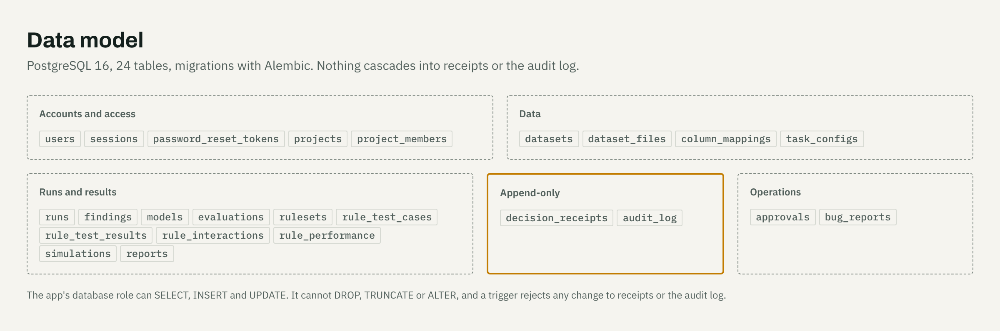</picture></td>
<td width="50%"><picture><source media="(prefers-color-scheme: dark)" srcset="docs/images/security-dark.png">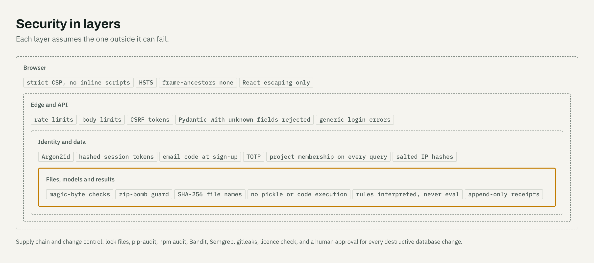</picture></td>
</tr>
</table>

<picture>
  <source media="(prefers-color-scheme: dark)" srcset="docs/images/delivery-dark.png">
  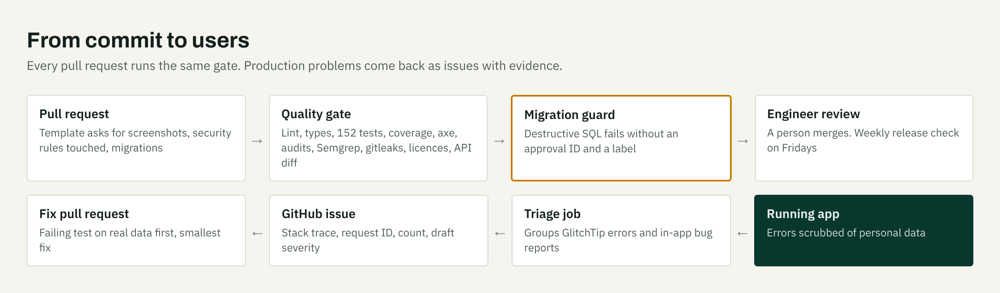
</picture>

## Measured results

Full ULB credit card fraud dataset: 284,807 real transactions, stratified test split of 56,962, prevalence 0.172%. The test split is never used for training or tuning. Full write-up: [docs/RESULTS.md](docs/RESULTS.md).

| Model | PR-AUC | ROC-AUC | Best F1 | Fraud caught | Alerts that are fraud |
|---|---:|---:|---:|---:|---:|
| Logistic regression | 0.718 | 0.971 | 0.703 | 84.7% | 60.1% |
| Random forest | 0.862 | 0.966 | 0.868 | 83.7% | 90.1% |
| XGBoost | 0.881 | 0.975 | 0.871 | 82.7% | 92.0% |
| **LightGBM** | **0.886** | **0.979** | **0.889** | 81.6% | **97.6%** |

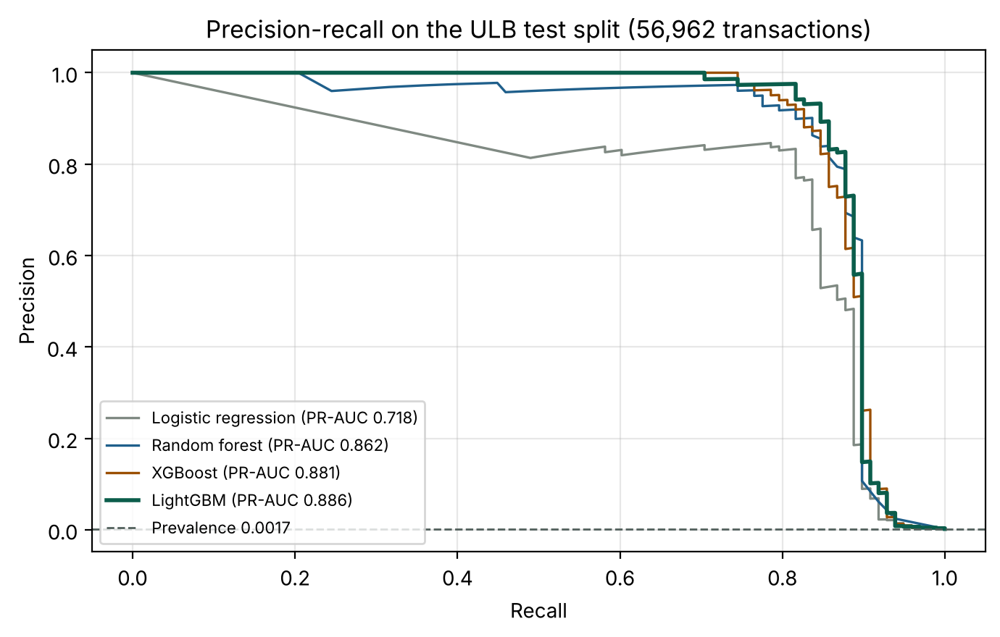

Accuracy is 99.96% for LightGBM, but a model that flags nothing already scores 99.83%, so the app leads with PR-AUC, recall and precision. On German Credit (1,000 applicants) accuracy is 74 to 75% against a 70% baseline, which is typical for that dataset.

The Fault Checker found **99 of 100** defects planted in copies of real data (leakage, train-test contamination, flipped labels, numbers stored as text, bad thresholds, broken prediction files, rule misfires) with **0 false alarms** on the clean data.

## Engineering

<b>Stack, security, tests and CI</b>

| Area | What's in place |
|---|---|
| **Backend** | FastAPI, Pydantic v2, SQLAlchemy 2, Alembic, PostgreSQL 16. Business logic in plain services with no web framework imports |
| **Machine learning** | pandas, scikit-learn, XGBoost, LightGBM, imbalanced-learn. Preprocessing fit on training data only; stratified, temporal and group splits; tuning on training folds only; every metric checked against scikit-learn |
| **Jobs** | Run queue in PostgreSQL with `SKIP LOCKED`; each run in its own process with memory and CPU limits, heartbeat and cancel; more workers can be added without code changes |
| **Frontend** | React 18, strict TypeScript, Vite, Tailwind on design tokens, Radix primitives, Recharts with a table view for every chart. Light and dark themes meet WCAG 2.2 AA |
| **Auth** | Argon2id passwords, server-side sessions with hashed tokens, CSRF tokens, lockout, rate limits, 6-digit email code at sign-up, optional authenticator 2FA |
| **Security** | Strict CSP, project membership on every query, magic-byte upload checks, zip-bomb guard, no pickle or code execution, rules interpreted from JSON, append-only receipts and audit log, least-privilege database roles |
| **Plans** | Free and Pro plans with limits enforced on the server |
| **Tests** | 97 backend tests on PostgreSQL (auth, CSRF on every route, cross-project access, database grants, uploads, metrics, rules, defects), 53 frontend tests including colour contrast for every token pair, 2 browser end-to-end runs with accessibility checks at 375, 768 and 1280 px |
| **CI on every pull request** | Lint, types, tests with coverage gates, Bandit, Semgrep, pip-audit, npm audit, gitleaks, licence check, API breaking-change check, Docker build, browser walkthroughs |
| **Safe migrations** | Destructive SQL fails CI unless it names a recorded approval and the pull request carries an approval label; the app's database role cannot drop or truncate |
| **Production errors** | GlitchTip with personal data scrubbed; a triage job groups errors and in-app bug reports into GitHub issues |

Write-ups: [Architecture](docs/ARCHITECTURE.md) · [Security](docs/SECURITY.md) · [Results](docs/RESULTS.md) · [API reference](docs/api/openapi.json)

## Honest limitations

- Results are on historical public datasets. Fintestix is not connected to any bank and makes no compliance claims.
- IEEE-CIS and Home Credit allow only non-commercial use; Fintestix never ships those files, users upload data they are allowed to use.
- The free hosting tier sleeps when idle, so the first request after a quiet period is slow.
- Online payment for the Pro plan is planned; for now an admin upgrades accounts.

## About the source code

This repository is the public overview of Fintestix. The source code (backend, analysis engines, web app, tests, notebooks and CI) is in a private repository. If you are reviewing my work for a role, open an issue or message me through my GitHub profile and I will give you read access or walk you through the code.

## Licence

All rights reserved. The text, diagrams and screenshots here may be viewed on GitHub; any other use needs written permission. See [LICENSE](LICENSE).
