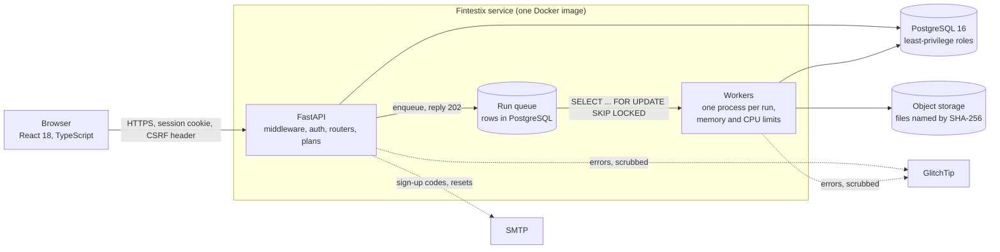
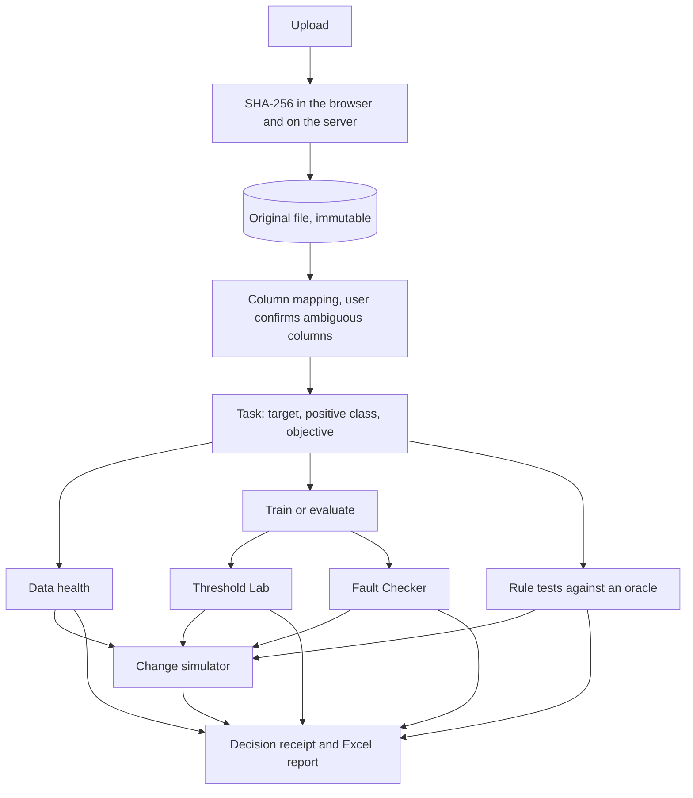

# Architecture: Fintestix

How the product is built and how its parts connect.

## 1. System overview

| Part | Job |
|---|---|
| Web app | Every screen. Holds no secrets and no business logic |
| API | Sign-in, permissions, validation, metadata, starting runs, serving results |
| Workers | Long jobs: profiling, training, evaluation, fault scans, rule tests, simulations, reports |
| PostgreSQL | Users, sessions, projects, runs, results, receipts, audit log |
| Object storage | Original uploads (never modified), processed Parquet, model files, reports |
| GlitchTip | Error monitoring for failures that only happen in production |

## 2. Request lifecycle

What happens when an analyst starts a training run:

1. Middleware assigns a request ID, enforces the body limit and adds security headers.
2. The session is loaded by the hash of the cookie token and checked for idle and absolute expiry.
3. The CSRF token, rate limit and plan quota are checked.
4. Project membership is checked. A user outside the project gets 404, so IDs reveal nothing.
5. Pydantic validates the body and rejects unknown fields.
6. A run row and an audit row are written in one transaction; the API replies 202 with the run ID.
7. A worker claims the run with `SKIP LOCKED` and keeps a heartbeat. Runs whose worker disappears are marked failed.
8. The run executes in a child process with memory, CPU-time and wall-clock limits.
9. Results and findings are stored and a receipt is sealed with a SHA-256 of its canonical JSON.
10. The browser polls every 2 seconds and shows the current step and elapsed time.

## 3. Data flow

Original files are never edited. Every derived artifact records the hash of its input and the version of the code and configuration that produced it, so any run can be reproduced.

## 4. Data model

24 tables in PostgreSQL, managed with Alembic migrations.

| Group | Tables |
|---|---|
| Accounts and access | users, sessions, password_reset_tokens, projects, project_members |
| Data | datasets, dataset_files, column_mappings, task_configs |
| Runs and results | runs, findings, models, evaluations, rulesets, rule_test_cases, rule_test_results, rule_interactions, rule_performance, simulations, reports |
| Append-only | decision_receipts, audit_log |
| Operations | approvals, bug_reports |

The application's database role can read, insert and update. It cannot drop, truncate or alter tables, and a trigger rejects any update or delete on receipts and the audit log.

## 5. Scaling

| Pressure | Path |
|---|---|
| More concurrent runs | Add worker processes or containers; the `SKIP LOCKED` queue already supports it |
| More API traffic | Run more API containers behind a load balancer; sessions live in PostgreSQL, not in memory |
| Storage growth | Switch the file store to S3-compatible storage (MinIO, Cloudflare R2) with one setting |
| Very large files | Columnar reads with Polars or DuckDB for profiling |

## 6. Deployment

- **Free:** one Render web service (API, web app and an embedded worker), a Neon PostgreSQL database and a Cloudflare R2 bucket.
- **Self-hosted:** Docker Compose with Caddy for automatic HTTPS, the API, a worker and PostgreSQL on one Linux server.
