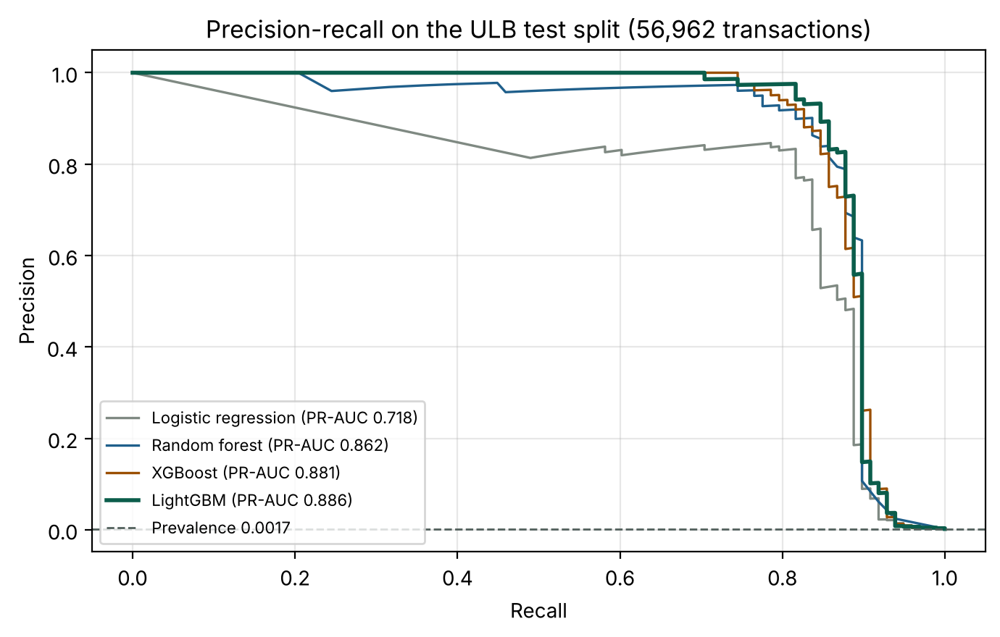

# Results: Fintestix

All numbers below come from logged runs on real public data. Each model uses a stratified 80/20 split with seed 42; the test split is never used for training or tuning. Every metric was recomputed independently with scikit-learn and matches.

## ULB credit card fraud

284,807 transactions from two days in September 2013, 492 of them fraud (0.172%). Test split: 56,962 transactions, 98 fraud.

| Model | Accuracy at 0.5 | PR-AUC | ROC-AUC | Best F1 | Threshold | Fraud caught | Alerts that are fraud | Run |
|---|---:|---:|---:|---:|---:|---:|---:|---|
| Logistic regression | 97.45% | 0.718 | 0.971 | 0.703 | 0.995 | 84.7% | 60.1% | R-2AAS3M |
| Random forest | 99.95% | 0.862 | 0.966 | 0.868 | 0.435 | 83.7% | 90.1% | R-R2D86D |
| XGBoost | 99.95% | 0.881 | 0.975 | 0.871 | 0.775 | 82.7% | 92.0% | R-FGJRS7 |
| **LightGBM** | **99.96%** | **0.886** | **0.979** | **0.889** | 0.990 | 81.6% | **97.6%** | R-GGJH7C |

A model that never flags anything scores 99.83% accuracy here, which is why the app leads with PR-AUC, recall and precision.

What the threshold changes for LightGBM on the 98 test fraud cases:

| Threshold | Caught | Missed | False alarms | Precision | Recall |
|---:|---:|---:|---:|---:|---:|
| 0.10 | 86 | 12 | 25 | 0.775 | 0.878 |
| 0.30 | 84 | 14 | 15 | 0.848 | 0.857 |
| 0.50 | 84 | 14 | 11 | 0.884 | 0.857 |
| 0.90 | 83 | 15 | 7 | 0.922 | 0.847 |
| 0.99 | 80 | 18 | 2 | 0.976 | 0.816 |

Training the same model again with the same data, configuration and seed gives identical test scores.

## Statlog German Credit

1,000 applicants, 30% bad loans, 20 coarse attributes.

| Model | Accuracy at 0.5 | PR-AUC | ROC-AUC |
|---|---:|---:|---:|
| Logistic regression | 75.0% | 0.633 | 0.806 |
| Random forest | 75.0% | 0.652 | 0.809 |
| XGBoost | 75.0% | 0.650 | 0.787 |
| LightGBM | 74.0% | 0.631 | 0.764 |

Always predicting "good" gives 70%. Results around 75% are typical for this small dataset.

## Fault Checker on planted defects

Each defect is planted in an in-memory copy of real data, 10 seeds each. The clean column runs the same check on unmodified data.

| Defect | Detected | False alarms on clean data |
|---|---:|---:|
| Copy of the target added as a feature (confirmed by retraining) | 10/10 | 0/10 |
| Target plus small noise as a feature | 10/10 | 0/10 |
| Duplicate rows across train and test | 10/10 | 0/10 |
| 5% labels flipped among identical rows | 10/10 | 0/10 |
| Numbers stored as text with commas | 10/10 | 0/10 |
| Threshold left at 0.5 on extreme imbalance | 10/10 | 0/10 |
| Prediction file with duplicate and missing IDs | 10/10 | 0/10 |
| Rule priority swapped | 9/10 | 0/10 |
| Boundary operator changed (>= to >) | 10/10 | 0/10 |
| Rule shadowed by a broader earlier rule | 10/10 | 0/10 |

Total: 99 of 100 detected, 0 false alarms. A real finding along the way: the ULB data contains transactions whose model features are identical but whose time differs, so a random split puts some of them in both train and test. Fintestix reports this on the unmodified data.

## Scope

The defect "random split on time-ordered data" needs the Lending Club file, which is not redistributed, so it is outside this benchmark rather than estimated.
